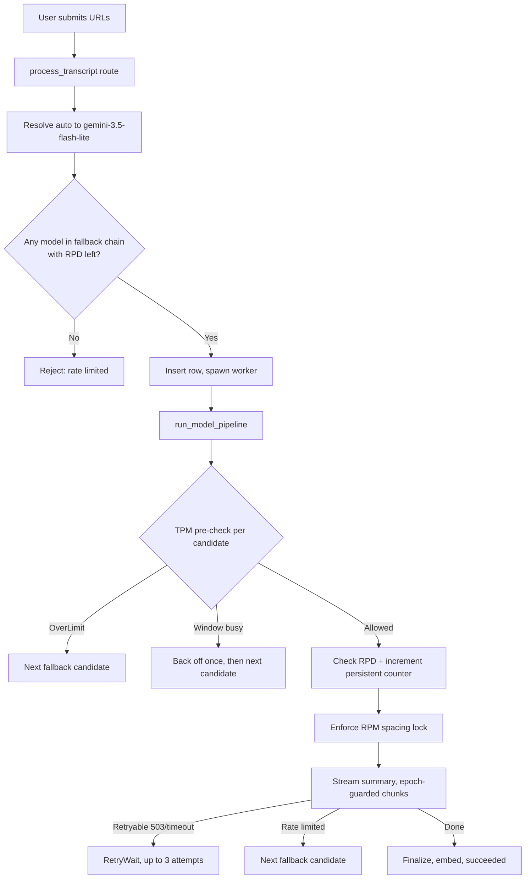

# Rate Limiting & Error Handling Architecture

How `rs-summarizer` stays inside provider quotas (RPM, TPM, RPD), degrades
gracefully when quotas run out, and reports failures to users in German.

---

## 1. Model Tiers: Cheap Models Never Escalate

`AUTO_MODEL = "gemini-3.5-flash-lite"` (newest 500-RPD model). There is no
video-length heuristic: `auto` always resolves to this model and its regular
fallback chain applies.

`ModelOption::is_expensive()` separates the pricing tiers (threshold just
above `gemini-3.5-flash-lite` at 0.30/2.50). The fallback chains in
`get_fallback_chain` (`src/tasks.rs`) guarantee the invariant: **a cheap or
free model never falls back onto an expensive-tier model, and no model ever
falls back onto a strictly more expensive one.** `gemma-4-*` models appear in
no automatic chain: their 16K TPM cap makes them unsuitable as fallbacks.

## 2. Three Quota Dimensions

Configured per model in `ModelOption` (`config/models.json`,
`src/state.rs::get_default_models`); `tpm_limit: 0` means "no per-minute
cap" (Hetzner).

### 2.1 RPM: Per-Model Spacing Lock

`enforce_rpm_limit` (`src/tasks.rs`) serializes requests per model with
`60 / rpm_limit` seconds spacing via `AppState::model_locks`.

### 2.2 TPM: Sliding 60-Second Window

`TpmTracker` (`src/services/rate_limiter.rs`, held in
`AppState::tpm_tracker`) keeps per-model 60-second windows of estimated
token usage. `run_model_pipeline` estimates the prompt
(`chars / 4 + 12_000` tokens of system/few-shot/directive overhead) and, for
every fallback candidate:

* `OverLimit` (prompt exceeds the whole window, e.g. a 25k-token transcript
  on Gemma 4 with 16K TPM): skip the candidate; if nothing fits, the user
  gets a German message explaining the per-minute limit.
* `Wait`: back off once until budget frees up, then yield to the next
  candidate instead of stalling the pipeline.
* `Allowed`: record the reservation and proceed.

### 2.3 RPD: Persistent Daily Counters

Daily counters live in **two** places: the in-memory `model_counts` map and
the `model_daily_usage(day, model, count)` SQLite table (migration `011`).
`check_rate_limit_persistent` / `increment_counter_persistent` write through
to SQLite, and `main.rs` reloads today's counters at startup — so **a server
restart no longer resets (or double-spends) the daily quotas**. Day
rollover reloads from the table instead of just clearing memory.

The submit route resolves `auto` first and calls
`RateLimiter::check_chain_available`: the submission is rejected only when
**every** model in the effective fallback chain exhausted its RPD — not at
the first tired primary.

### 2.4 Exact DST Handling (`today_la()`)

Quota days are America/Los_Angeles days. The transition uses the exact US
Pacific switchover instants — 02:00 local on the 2nd Sunday of March
(= 10:00 UTC) and the 1st Sunday of November (= 09:00 UTC) — instead of
comparing UTC calendar dates, so the reset lands precisely at LA midnight
even on transition days.

## 3. Generation Lifecycle & Error Handling

`GenerationStatus` (`queued → running → retry_wait → succeeded`, or
`failed` / `partial_failed`) with `generation_epoch` ownership: streaming
chunks persist via `append_summary_chunk_for_epoch`, so a stale stream from
a superseded attempt cannot corrupt a retry's body (`MAX_RETRY_ATTEMPTS = 3`
with exponential `retry_delay`).

* **Retryable** (`high demand`, `503`, connection loss, truncated stream):
  transition to `retry_wait` with a public retry timestamp, sleep, reclaim
  the row, and resume.
* **Rate limited** (`429` / `ResourceExhausted`): try the next model in the
  fallback chain instead of failing.
* **TPM over limit**: skip the candidate; the final error names the model,
  the estimate, and the cap.
* **User-facing messages** (`user_facing_error_message`, `src/tasks.rs`) are
  always German and never leak raw API or `yt-dlp` internals.

## 4. Serial `yt-dlp` Execution

External downloads are the flakiest part of the pipeline. Confinement:

* `DownloadLimiter` defaults to `MAX_CONCURRENT_YTDLP = 1` (strictly
  serial — parallel `uvx yt-dlp` processes reliably freeze the server) with
  `YTDLP_DELAY_MS = 2000` between runs.
* Every `uvx` invocation goes through `run_uvx` (`src/services/transcript.rs`)
  with `.kill_on_drop(true)` and a `YTDLP_TIMEOUT_SECS` timeout (default
  90 s) surfacing as `TranscriptError::Timeout` — no zombie processes from
  aborted futures.

## 5. Thinking Levels

Persisted per summary (`thinking_level`, migration `006`, widened to
`xhigh` by `011`). The capability table `supported_thinking_levels` in
`src/state.rs` replaces string-prefix checks: `gemini-4-hydrogen` supports
`low..xhigh`, `gemini-3.8-flash` supports `low..high` (no `minimal`),
`3.6/3.5-lite/3.1-lite/3-flash-preview` support `minimal..high`, everything
else only `auto`. `effective_thinking_level` (`src/services/summary.rs`)
clamps across generations so a fallback never fails with HTTP 400
(`xhigh → high`, `minimal → low`); `xhigh` on hydrogen streams through a
raw SSE call because `gemini-rust 2.0.0` has no `XHigh` variant.

## 6. HN Article Fetch (SSRF)

`HackerNewsService::fetch_external_article` only fetches `http(s)` URLs,
follows at most 5 redirects manually (each hop re-validated), rejects
loopback/private/link-local/unspecified/multicast/CGNAT/ULA addresses for
**every** resolved IP, and caps the body at 5 MiB before decoding.
