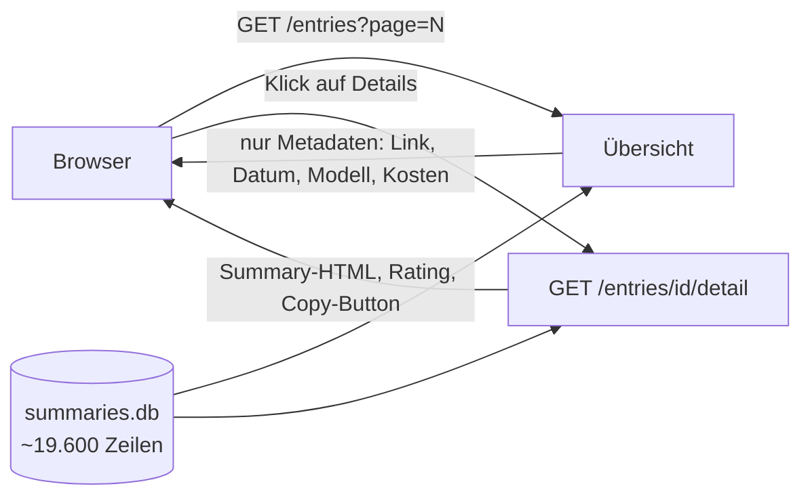

# Walkthrough: Datenbank-Browser für alle Einträge

Dieser Walkthrough beschreibt den neuen **Entries-Browser**: eine schlanke
Übersichtsseite über *alle* Zeilen der Datenbank, bei der Details erst auf
Klick nachgeladen werden. Der Volltext (das Roh-Transkript) erreicht den
Browser dabei **niemals**.

## 1. Was exakt implementiert wurde

### Das Problem

`/browse` rendert pro Seite 20 komplette Zusammenfassungen sofort als HTML.
Bei ca. 19.600 Zeilen in `summaries.db` ist das als Übersicht zu schwer:
viel übertragene Daten, langsamer Seitenaufbau — schlecht für geringe
Datenraten.

### Die Lösung: zwei Endpunkte statt einem



**`GET /entries?page=N`** — die Übersichtsseite (`templates/entries.html`):

- Tabelle mit 50 Zeilen pro Seite, sortiert nach `identifier DESC`
  (neueste Einträge zuerst, seitenweise bis zur letzten Seite blätterbar).
- Pro Zeile nur **Metadaten**: ID, klickbarer Original-Link (auf 60 Zeichen
  gekürzt), Anfrage-Zeitpunkt (`summary_timestamp_start`), Modell und
  formatierte Kosten (wiederverwendet aus `cost_display`: ab 1 Cent zwei
  Stellen, darunter drei).
- Die SQL-Abfrage (`db::fetch_entries_page`) lädt per expliziter
  `SELECT`-Projektion **kein** `transcript`, **kein** `summary` und **keine**
  Embeddings. Das ist der Kern des Datenraten-Gewinns.

**`GET /entries/{identifier}/detail`** — das Detail-Fragment
(`templates/entry_detail.html`):

- Wird erst geladen, wenn man ein `<details>`-Element aufklappt. Technisch
  steckt dahinter [HTMX](https://htmx.org): ein Attribut
  `hx-get="/entries/123/detail"` mit Auslöser `toggle once` lädt das
  Fragment genau einmal nach — ganz ohne eigenes JavaScript.
- Zeigt das gerenderte Summary-HTML (mit anklickbaren YouTube-Zeitstempeln),
  Modell, Kosten, Source-Link, die Sterne-Bewertung und den
  „Für YouTube kopieren“-Button — also alles wie auf `/browse`.
- Die Detail-Abfrage (`db::fetch_entry_detail`) selektiert ebenfalls **ohne**
  `transcript`-Spalte. Der Volltext kann daher nicht versehentlich in die
  Antwort geraten: Was nicht aus der Datenbank gelesen wird, kann nicht
  angezeigt werden. Unbekannte IDs liefern sauber `404` statt `500`.

Weitere Anpassungen:

- `/browse` bleibt **unverändert** bestehen; die Startseite (`/`) verlinkt
  zusätzlich auf `/entries`.
- Legacy-Zeilen (z. B. `NULL`-Kosten, fehlende Zeitstempel) rendern dank
  `COALESCE`-Lesart fehlerfrei — übernommen aus dem bestehenden `db.rs`-Muster.

### Code-Beispiel: schlanke Projektion

```rust
// src/db.rs — die Übersicht liest nur 5 leichte Spalten:
"SELECT identifier, \
 COALESCE(model, '') AS model, \
 COALESCE(original_source_link, '') AS original_source_link, \
 COALESCE(summary_timestamp_start, '') AS summary_timestamp_start, \
 COALESCE(cost, 0.0) AS cost \
 FROM summaries ORDER BY identifier DESC LIMIT ? OFFSET ?"
```

## 2. Architektur- und Designentscheidungen

- **Lazy-Load statt Eager-Render:** 50 Summaries à ~5–8 KB pro Seite wären
  wieder ~300 KB. Deshalb lädt die Übersicht nur Metadaten; Details kommen
  pro Eintrag auf Klick. Das hält jede Seite klein und schnell.
- **`<details>` + HTMX statt eigenem JS:** Das Aufklapp-Verhalten liefert
  HTML von Haus aus; HTMX (bereits im Projekt) übernimmt das Nachladen.
  Kein neues Framework, keine neue Abhängigkeit (`deps.md` war nicht nötig).
- **Sicherheit durch Abfrage-Design:** Statt das Transkript zu laden und im
  Template zu verstecken, wird es gar nicht erst selektiert. Die Typen
  `EntryRow`/`EntryDetail` enthalten schlicht kein Transkript-Feld — der
  Compiler wacht mit.
- **Abweichung vom Plan:** Der Plan sah nur `toggle once` als Auslöser vor;
  umgesetzt wurde `toggle once from:closest details`, damit das Ereignis des
  `<details>`-Elements sicher das innere Lade-`<div>` triggert (das
  `toggle`-Ereignis sprudelt nicht nach oben, daher der explizite Bezug).

## 3. Learnings und mögliche Erweiterungen

- **Gelernt:** Die Zeitstempel-Verlinkung (`replace_timestamps_in_html`)
  greift nur bei *gültigen* YouTube-IDs (`validate_youtube_url`). Ein Test
  mit erfundener ID (`watch?v=entries123`) schlug deshalb fehl — kein
  Produktfehler, sondern eine zu lockere Testannahme. Merksatz: Testdaten
  müssen die Validierungsregeln der Helfer erfüllen.
- **Gelernt:** Chrome-for-Testing (Headless-Shell + Chromedriver, Version
  156) lässt sich ohne Paketmanager direkt von Google-Servern laden und
  funktioniert mit dem vorhandenen Fantoccini-Harness über
  `TEST_BROWSER=chromium`, `CHROME_BINARY` und `CHROMEDRIVER`.
- **Mögliche Erweiterungen:**
  - Suche/Filter in `/entries` (z. B. nach Modell oder Link-Text).
  - Sortierung umschaltbar (älteste zuerst).
  - Zähler „Eintrag X–Y von insgesamt Z“ in der Navigation.

## 4. Neue Programme/Pakete für das Dockerfile

Für den Produktivbetrieb ist **nichts** Neues nötig (keine neuen Crates,
keine Laufzeit-Abhängigkeiten). Nur für automatisierte Browser-Tests in
CI/Containern:

- `chromedriver` (Version passend zum Browser, hier 156.0.8078.47) und eine
  Chrome-Binärdatei (empfohlen: `chrome-headless-shell` von
  Chrome-for-Testing) — oder alternativ Firefox + `geckodriver`.
- Die Tests laufen mit:
  `TEST_BROWSER=chromium CHROME_BINARY=… CHROMEDRIVER=… cargo test --test integration_browser -- --ignored`
