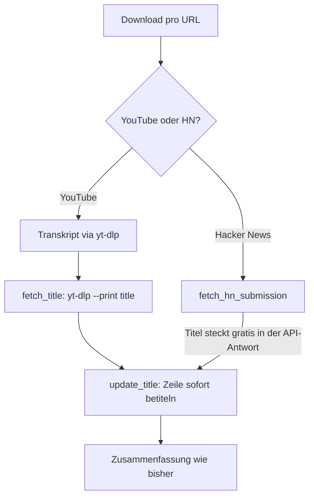

# Walkthrough: Titel für YouTube-Videos und HN-Posts

Jeder Eintrag zeigt jetzt seinen **Titel** — in `/browse`, in der
`/entries`-Übersicht und im lazy geladenen Detail. Neue Titel werden schon
beim Herunterladen gespeichert; die ca. 19.600 Altdaten füllt ein
ratenbegrenzter Hintergrundprozess nach und nach auf.

## 1. Was exakt implementiert wurde

### Datenbankschema (Migration `010_add_title.sql`)

- `summaries.title TEXT NOT NULL DEFAULT ''` — der Default `''` bedeutet:
  Alle Altdaten sind sofort lesbar, nur eben noch titellos.
- `title_fetch_budget(day, source, count)` — Tageszähler je Quelle
  (`youtube`/`hackernews`), per UTC-Tag geschlüsselt. Dadurch überlebt das
  Budget einen Neustart (kein doppeltes Verbrauchen, kein Zurücksetzen).

### Titel schon beim Download



- **YouTube:** `TranscriptService::fetch_title` ruft `yt-dlp --no-playlist
  --skip-download --print title` mit denselben Cookie-/POT-Argumenten wie der
  Transkript-Download. Best-Effort: Fehlschlag → Titel bleibt leer, die
  Zusammenfassung läuft trotzdem.
- **Hacker News:** `fetch_hn_content` liefert jetzt zusätzlich den
  Post-Titel aus `HnFetchResult` — **kein einziger zusätzlicher Request**.
  Für den Backfill gibt es `fetch_story_title` (nur 1 Item-Request, ohne
  Kommentare und ohne Artikel-Download).

### Backfill mit Ratenlimit (`tasks::title_backfill_loop`)

- Läuft als Hintergrundtask ab Serverstart (60 s Anlaufverzögerung), alle 10
  Minuten ein Schritt mit bis zu 10 URLs (`TITLE_BACKFILL_INTERVAL_SECS`,
  `TITLE_BACKFILL_BATCH`).
- Budgets: **100/Tag YouTube** (`TITLE_YT_PER_DAY`), **1000/Tag HN**
  (`TITLE_HN_PER_DAY`) — jeder Versuch zählt, auch Fehlschläge, damit defekte
  URLs die Gegenstelle nicht hämmern.
- **Duplikate:** `fetch_untitled_urls` liefert jede URL nur einmal
  (`GROUP BY original_source_link`), `update_title_for_url` schreibt den
  Titel auf alle betroffenen Zeilen. URL-lose Paste-Einträge werden
  übersprungen; Fehler loggen und weiter.
- Die bestehenden `DownloadLimiter`-Semaphoren werden mitbenutzt, damit der
  Backfill laufende Generierungen nicht überlastet.

### Anzeige

- `/entries`: neue **Titel-Spalte** (Fallback `—`), Detail-Fragment mit
  `<h3>`-Titel; Loader-Div bekam die Klasse `entry-detail-loader` für
  gezielte Tests.
- `/browse`: `<h3>`-Titel über jeder Summary; ohne Titel kein Heading
  (Fallback ist der Source-Link darunter).
- Leere Titel rendern überall ohne Fehler.

### Robustheit für alte Datenbanken

`SUMMARY_COLUMNS` wird zur Laufzeit ergänzt: Per
`pragma_table_info`-Prüfung (`has_title_column`) lesen alle vier
Lesefunktionen (`fetch_summary`, `fetch_browse_page`, `fetch_entries_page`,
`fetch_entry_detail`) auf Pre-010-Datenbanken ohne `title`-Spalte — die
Structs tragen `#[sqlx(default)]`, sodass der Titel zu `""` wird. So rendert
die 2,1-GB-`summaries.db`-Kopie (read-only, nicht migrierbar) weiterhin
vollständig statt leer.

### Code-Beispiel: Titel-Fetch via yt-dlp

```rust
// src/services/transcript.rs
args.extend([
    "--no-playlist".to_string(),
    "--skip-download".to_string(),
    "--print".to_string(),
    "title".to_string(),
    url.to_string(),
]);
```

## 2. Architektur- und Designentscheidungen

- **Budget-Tabelle statt In-Memory:** Neustarts sind im Produktivbetrieb
  normal (Deploys) — ein Speicher-Zähler würde das Tageslimit jedes Mal
  zurücksetzen. Die paar Zeilen in `title_fetch_budget` sind billiger als
  jedes versehentliche Rate-Limit.
- **Jeder Versuch zählt:** Auch Fehlschläge verbrauchen Budget. Begründung:
  Jeder Versuch ist echter Traffic bei YouTube/HN; ein dauerkaputtes Video
  darf nicht alle 10 Minuten neu anfragen.
- **Fallback-Projektion statt striktem Schema:** Abweichung vom Plan — der
  sah nur die Migration vor. Beim Testen gegen die echte `summaries.db`
  zeigte sich: 2,1 GB lassen sich für Tests weder kopieren noch migrieren.
  Die Laufzeit-Prüfung hält die Regressionstests auf der echten DB
  aussagekräftig (volle Seiten statt leerer).
- **Kein Titel im Generierungs-Partial:** Bewusst außerhalb des Auftrags
  (`browse`/`entries` waren gefordert); das Partial zeigt Modell/Kosten wie
  bisher.

## 3. Learnings und mögliche Erweiterungen

- **Gelernt:** `#[sqlx(default)]` erlaubt fehlende Spalten beim Decodieren —
  ideal für abwärtskompatible Projektionen.
- **Gelernt:** Fantoccini-Selektoren wie `details div` treffen nach
  HTMX-Nachladen auch verschachtelte Divs (Rating-Partial). Seitdem trägt der
  Loader eine eigene Klasse.
- **Gelernt:** Test-URLs müssen die Validatoren erfüllen (`validate_youtube_url`
  verlangt echte 11-Zeichen-IDs) — sonst testen wir nur den Fallback.
- **Erweiterungen:** Titel-Suche/Filter in `/entries`; Backfill-Fortschritt
  (z. B. „noch X titellos“) als Admin-Zeile; externe Artikel-Titel statt
  HN-Post-Titel als Option.

## 4. Neue Programme/Pakete für das Dockerfile

Keine für den Betrieb (keine neuen Crates; yt-dlp/uvx und HN-Zugriff
existieren bereits). Für Browser-Tests in CI wie bisher Headless-Chrome +
Chromedriver (Version passend zueinander, hier 156.0.8078.47):
`TEST_BROWSER=chromium CHROME_BINARY=… CHROMEDRIVER=… cargo test --test integration_browser -- --ignored`.
Neue Env-Variablen (alle optional, mit Defaults): `TITLE_YT_PER_DAY` (100),
`TITLE_HN_PER_DAY` (1000), `TITLE_BACKFILL_BATCH` (10),
`TITLE_BACKFILL_INTERVAL_SECS` (600).
