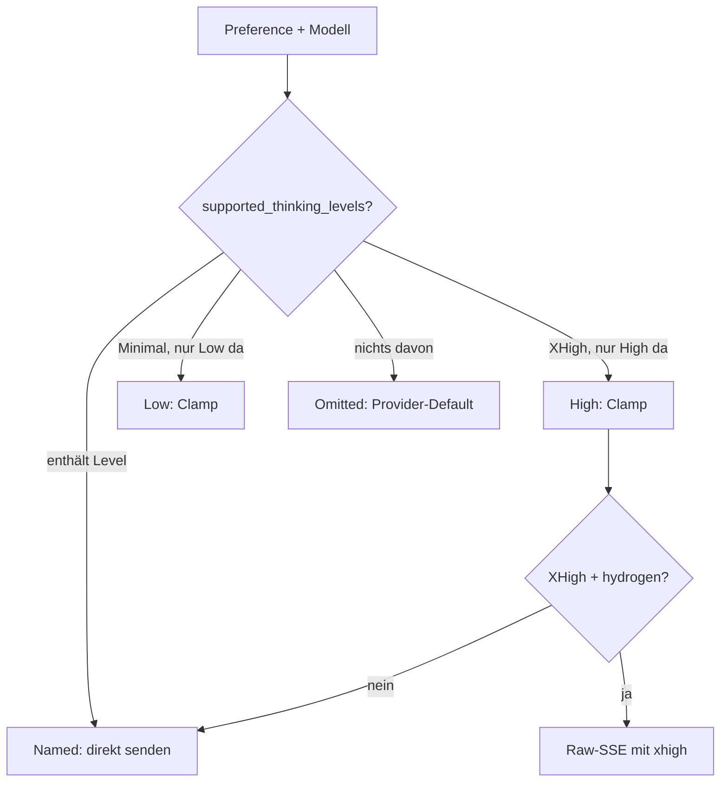
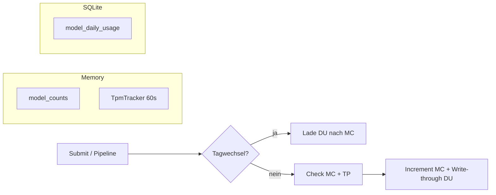
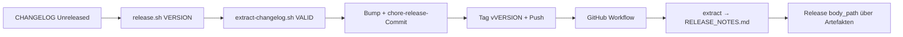

# Walkthrough: Modell-Update, Architektur-Fixes, Titel-Backfill-Analyse, CHANGELOG & Release-Workflow (2026-11-15)

Ziel dieses Updates: `rs-summarizer` auf den neuen Modellkatalog (`gemini-4-hydrogen` mit `xhigh`,
`gemini-3.5-flash-lite` als neues `auto`) umstellen, bekannte Architektur-Schwächen beheben
(RPD-Neustart-Verlust, DST-Ungenauigkeit, fehlendes TPM-Limit, SSRF im HN-Fetcher, Zombie-`yt-dlp`s),
die Titel-Aufholjagd anhand des Produktions-Backups vermessen, ein englisches `CHANGELOG.md`
einführen und den Release-Workflow auf Changelog-Notizen umstellen.

Alle Qualitätsgates sind grün: `cargo fmt --check`, `cargo clippy --all-targets --all-features --
-D warnings`, `cargo test` (181 Unit-Tests plus alle Integrations-Suites), `./scripts/release-check.sh`.

---

## 1. Was exakt implementiert und behoben wurde

### 1.1 Auswertung des Produktions-Backups: der YouTube-Titel-Backfill läuft, aber langsam

Datenbank `summaries_20261115.db.zst` (nur lesend nach `/tmp` entpackt, am Ende gelöscht).
Alle Zahlen sind exakte Abfrageergebnisse (SQLite, `readonly`):

| Kennzahl | Wert |
|---|---|
| YouTube-Zeilen gesamt | 17.168 |
| davon betitelt | 519 (3,02 %) |
| davon unbetitelt | 16.649 Zeilen |
| unterschiedliche YouTube-URLs gesamt | 13.487 |
| davon betitelt (distinct) | 300 |
| davon unbetitelt (distinct) | 13.207 |
| Budget-Einträge `title_fetch_budget` | 23 Tage × 100 Versuche = 2.300 (Quelle: nur `youtube`) |
| Budget-Zeitraum | 2026-10-24 bis 2026-11-15, **jeden Tag exakt 100** |

Tagesverlauf: Das Budget ist an allen 23 Tagen voll ausgeschöpft — der Backfill-Loop läuft
zuverlässig und hängt nicht. Aber 2.300 Versuche stehen nur ~73 zusätzlich betitelten
Legacy-URLs gegenüber (300 distinct betitelt insgesamt, davon ~227 aus neuen Zeilen, die ihren
Titel bereits bei der Erstellung erhalten).

Monatsverteilung (betitelte Zeilen): Nur drei Monate haben überhaupt Titel —
2024-12 (100 von 160), 2026-10 (284 von 703) und 2026-11 (135 von 189). Alle Monate von
2025-01 bis 2026-09 haben **0** betitelte Zeilen. Versionssicht: Legacy-Zeilen mit leerer
Version sind zu 100 von 15.647 betitelt, `1.10.1`-Zeilen zu 419 von 481 (Erstellungs-Titel seit
Release 1.10.0), `1.8.0`/`1.8.1`/`1.8.4`/`1.8.5` zu 0.

**Lesart:** Der Backfill arbeitet von alt nach neu (älteste `identifier` zuerst — so ist
`fetch_untitled_urls` sortiert) und hat 2024-12 fast geschafft. Danach verbrennt er sein
Tagesbudget an den 2025er-Kohorten: Deren Titel-Abrufe schlagen dauerhaft fehl (sehr
wahrscheinlich gelöschte oder private Videos — `yt-dlp` liefert dann nie einen Titel) und
werden jeden Tag erneut versucht, weil Fehlschläge keine Sperre hinterlassen. Die Tabelle
enthält außerdem **keine einzige `hackernews`-Budgetzeile**.

**Hochrechnung:** 13.207 unbetitelte distinct URLs ÷ 100 Versuche/Tag ≈ **133 Tage
(≈ 4,4 Monate)** — und das nur, falls jeder Versuch träfe. Bei der beobachteten Trefferquote
(2.300 Versuche → niedrige zweistellige Zahl neuer distinct URLs pro Tag im Schnitt) dauert es
realistisch deutlich länger. Konkrete Empfehlung als Folgearbeit: Fehlzähler pro URL
(`title_fetch_failures`) und URLs nach z. B. 10 Fehlschlägen dauerhaft überspringen, statt das
Tagesbudget an toten URLs zu verbrennen.

### 1.2 Modellkatalog, Thinking-Levels und `xhigh`

* `config/models.json` und `get_default_models()` sind synchron auf dem neuen 12er-Katalog
  (Tabelle aus dem Plan, inkl. `tpm_limit` mit `#[serde(default)]`, `0` = kein Limit).
  `gemini-3.7-flash`, `gemini-3.5-flash` und `gemini-2.5-flash` sind entfernt.
* `ThinkingPreference::XHigh` (`"xhigh"`) ist persistiert, per Migration `011` in der
  Datenbank erlaubt und in der UI als `Extra High (xhigh)` wählbar.
* Die Capability-Tabelle `supported_thinking_levels()` in `src/state.rs` ersetzt alle
  `startsWith("gemini-3.")`-Prüfungen (Backend, Route-Validierung und Browser-JS lesen jetzt
  `data-thinking-levels` / `data-default-thinking` aus den `<option>`-Tags).
* `xhigh`-Versand: `gemini-rust 2.0.0` kennt kein `XHigh` (quellgeprüft im Cargo-Cache:
  `InteractionThinkingLevel::{Minimal, Low, Medium, High}`). Statt ein neues Crate zu holen,
  wird der fertig konfigurierte Builder-Request serialisiert, per JSON-Patch um
  `"thinking_level": "xhigh"` ergänzt und mit dem vorhandenen `reqwest`-Client an
  `.../v1beta/interactions?alt=sse` gestreamt (Header `x-goog-api-key`, manuelles
  SSE-Framing mit `chunk()`, jede `data:`-Zeile direkt in `InteractionEvent` geparst —
  derselbe `InteractionAccumulator` und dieselbe Epoch-geschützte Chunk-Schleife wie der
  SDK-Pfad).
* Clamping statt HTTP 400: `xhigh` → `high` auf Gemini 3.x, `minimal` → `low` auf
  `4-hydrogen`/`3.8-flash`. Ein Fallback über Modellgenerationen hinweg kann daher nie an
  einem abgelehnten Level scheitern.
* Kosten: `compute_cost` bleibt bei `total_output_tokens × Output-Preis`. Annahme (im Code
  dokumentiert, nicht live verifizierbar): Gemäß Google-Billing-Doku zählen Thinking-Tokens
  zu den Output-Tokens, `total_thought_tokens` wird nur zur Sichtbarkeit separat
  gespeichert. Re-Verifikation über `total_tokens` vs. Teilsummen bei echten
  Usage-Payloads steht aus (kein `GEMINI_API_KEY` in dieser Umgebung).

### 1.3 Fallback-Ketten ohne Eskalation

`AUTO_MODEL` ist jetzt `gemini-3.5-flash-lite`. Alle Ketten folgen der neuen Spezifikation;
die Tests sichern die Invariante maschinell: Sobald eine Kette die teure Klasse
(`ModelOption::is_expensive()`, Schwelle knapp über `3.5-flash-lite`) verlassen hat, betritt
sie sie nie wieder — ein günstiges Modell fällt also nie auf ein teures zurück. Gemma-Modelle
stehen in keiner automatischen Kette (16K-TPM-Limit).

### 1.4 Rate-Limiter: persistent, DST-exakt, TPM-begrenzt

* **Persistente RPD-Zähler:** `model_daily_usage(day, model, count)` (Migration `011`),
  Write-through in `increment_counter_persistent`, Neuladen bei Tageswechsel und beim
  Serverstart in `main.rs`. Ein Neustart setzt die Quoten nicht mehr zurück.
* **DST-Fix:** `today_la()` rechnet mit den exakten Umschalt-**Zeitpunkten** (2. Sonntag im
  März 10:00 UTC, 1. Sonntag im November 09:00 UTC) statt mit UTC-Kalendertagen. Reine
  Funktion `la_date_at()` + Tests exakt an den Sekunden vor/nach dem Umschalten
  (2026: 8. März und 1. November, beides Sonntage — verifiziert).
* **TPM-Fenster:** `TpmTracker` (60-s-Sliding-Window pro Modell, in `AppState`), Schätzung
  `Zeichen/4 + 12.000` Overhead (Few-Shot-Templates ≈ 36 KB, nachgemessen). Zu große Prompts
  (z. B. 25k-Token-Transkript auf Gemma-16K) brechen sofort mit deutscher Fehlermeldung ab;
  volle Fenster warten einmal und weichen dann aufs nächste Fallback-Modell aus.
* Die Submit-Route löst `auto` zuerst auf und lehnt nur ab, wenn die **gesamte** effektive
  Kette ihr RPD aufgebraucht hat.

### 1.5 Migration `011` (Herzstück der Datensicherheit)

`-- no-transaction` in Zeile 1 (von `sqlx 0.9` quellgeprüft unterstützt), dann
`PRAGMA foreign_keys = OFF`, Rebuild von `summaries` mit erweitertem CHECK
(`... 'high', 'xhigh'`), allen fünf bisherigen plus neuem `idx_summaries_title_url`-Index,
neuer Tabelle `model_daily_usage`, `COMMIT`, `PRAGMA foreign_key_check` / `foreign_keys = ON`.
Ohne `OFF` außerhalb einer Transaktion würde `DROP TABLE summaries` per
`ON DELETE CASCADE` alle `summary_ratings` löschen — genau das verhindert die Migration.
Legacy-NULLs werden per `COALESCE` auf Defaults normalisiert (Spaltenauswahl nachweislich an
`SUMMARY_COLUMNS` in `db.rs` angelehnt).

Verifikation doppelt:

1. **Echter Backup-Lauf:** Kopie `/tmp/summaries_mig_test.db` (2,2 GB) durch
   `sqlx::migrate!` — fehlerfrei in ~12 s, `summaries`- und `summary_ratings`-Zeilenzahl
   exakt gleich, `PRAGMA integrity_check = ok`, `PRAGMA foreign_key_check` leer,
   `xhigh`-Insert danach akzeptiert. (Kopie danach gelöscht.)
2. **Eingecheckter Test** `tests/migration_011.rs`: wendet den echten Migrations-Text auf
   eine Legacy-NULL-Datenbank mit Ratings an und prüft Zeilenerhalt, COALESCE-Defaults,
   CHECK-Verhalten (`xhigh` ok, `bogus` abgewiesen), Indizes, RPD-Roundtrip, Integrität.

### 1.6 Hetzner-Streaming gehärtet

* Chunks laufen über `append_summary_chunk_for_epoch` (Eigentumsschutz statt blindem
  Anhängen).
* Der Stream **muss** mit einer `finish_reason` enden, sonst Fehler
  (`... without finish reason` — bewusst mit `"stream ended"`-Wortlaut, damit die
  Retry-Logik in `tasks.rs` greift) statt stiller Veröffentlichung eines Fragments.
* Qwen-Thinking (`<think>…</think>` am Content-Anfang — `async-openai 0.41` hat kein
  `reasoning_content`-Feld, quellgeprüft) wird in `thinking_text` getrennt und landet nie
  als roher `<think>`-Block im HTML; ungeschlossene Blöcke fallen offen als Summary durch
  (65-KB-Schranke).
* `hetzner-qwen-3.8-27b` heißt jetzt kanonisch `Qwen/Qwen3.8-27B`. Der alte Fallback-Key im
  Code bleibt unangetastet stehen.
* **Live-Test nicht möglich:** Der gespeicherte Hetzner-Token wird von
  `https://inference.hetzner.com/api/v1/models` mit `unauthorized` abgelehnt (blind per
  Shell-Substitution übergeben, nie ausgegeben oder gespeichert); `GEMINI_API_KEY` ist in
  dieser Umgebung nicht gesetzt. `<think>`-Trennung und `finish_reason`-Logik sind daher nur
  per Unit-Test (Splitter, Chunk-Simulation) verifiziert — ein Live-Lauf gegen beide
  Qwen-Modelle steht aus.

### 1.7 Hacker News: SSRF-Schutz und Größenlimit

`fetch_external_article` prüft Schema (`http(s)`), folgt max. 5 Redirects manuell (jeder Hop
neu validiert, eigener `Policy::none()`-Client), löst den Host per `lookup_host` auf und
verwirft **alle** aufgelösten IPs bei Loopback/Private/Link-Local/Unspecified/Multicast/
CGNAT (`100.64.0.0/10`)/ULA. Body-Cap 5 MiB (Header-Check plus chunkweises Zählen).
Unit-Tests decken blockierte IPv4/IPv6-Bereiche, falsche Schemata und akzeptierte
öffentliche Adressen ab (reine IP-Literale und Schemata — ohne Netzwerk sondern
DNS-unabhängig).

### 1.8 `yt-dlp`: seriell, mit Timeout, ohne Zombies

Default `MAX_CONCURRENT_YTDLP = 1`, `YTDLP_DELAY_MS = 2000`. Alle drei Aufrufe laufen über
`run_uvx()` mit `.kill_on_drop(true)` und `YTDLP_TIMEOUT_SECS` (Default 90 s →
`TranscriptError::Timeout`, in der UI als deutsche YouTube-Blockade-Meldung). Bestehende
Verhaltenstests (`uvx`-Fehlermeldungen mit `cmd:`-Kontext) bleiben erhalten.

### 1.9 CHANGELOG, Skripte, Workflow, Doku

* `CHANGELOG.md` (Keep a Changelog, Englisch): `Unreleased` + `1.11.0` +
  Rückschau 1.7.0–1.10.1 aus `git tag`/`git log` + Compare-Links.
* `scripts/extract-changelog.sh` (ausführbar): extrahiert die Versionssektion (mit/ohne
  `v`-Präfix), Exit 1 bei fehlender/leerer Sektion — verifiziert positiv und negativ.
* `release-check.sh`: prüft zusätzlich `fmt --check`, striktes Clippy, `cargo test` und
  vorhandenes `CHANGELOG.md` (alle grün außer „Clean working tree", solange uncommitted).
* `release.sh`: befördert nicht-leeres `Unreleased` automatisch nach
  `## [<VERSION>] - <Datum>` (inkl. Compare-Link auf die höchste Vorgängerversion),
  validiert per `extract-changelog.sh`, committet `Cargo.toml`/`Cargo.lock`/`CHANGELOG.md`
  als `chore(release):`, taggt und pusht.
* `release.yml`: extrahiert Notizen nach `RELEASE_NOTES.md`, veröffentlicht sie per
  `body_path` **über den Artefakten**, benennt das Release und prüft zusätzlich
  `010`/`011` im Staging-Tarball (plus optionale `CHANGELOG.md`-Kopie).
* `README.md` dokumentiert den Release-Prozess; `RELEASE_README.md` die neuen
  `yt-dlp`-Defaults; `doc/rate_limiting_error_handling_architecture.md` ist komplett auf
  die tatsächliche Architektur umgeschrieben (statt veralteter Videolängen-Heuristik und
  falscher Ketten).
* Gelöscht: `src/cache.rs` (`MetadataCache`, nachweislich ohne Nutzer) + `pub mod cache`.

---

## 2. Architektur- und Designentscheidungen

### Warum keine Eskalation mehr, und was „teuer" heißt

Frühere Ketten ließen z. B. `gemini-3.5-flash-lite` auf `gemini-3.8-flash` zurückfallen —
stille Kosten-Eskalation ohne Nutzerzustimmung. Jetzt gilt: Ketten dürfen die teure Klasse
nur verlassen, nie betreten. „Teuer" ist dabei eine **Preisklasse**
(`input > 0,30 || output > 2,50`), kein Rang: `3.6 ↔ 3.8` (gleicher Preis) ist erlaubt,
`hetzner → 2.5-flash-lite` (beide billig) auch. Der Test
`test_fallback_chains_never_escalate_to_expensive_models` prüft das für alle registrierten
Modelle gegen den echten Katalog.

### Thinking-Clamping über Modellgenerationen

Der Clamp ist bewusst verlustbehaftet dokumentiert (Fallback `4-hydrogen → 3.x` denkt mit
`high` statt `xhigh` weiter, statt mit HTTP 400 zu sterben) und löst eine Warnung
(`fallback_downgrades_thinking_level`) aus.

### Rate-Limiter mit SQLite und TPM

### Release-Pipeline

### Warum `PRAGMA foreign_keys = OFF` + `-- no-transaction`

SQLite ignoriert `PRAGMA foreign_keys` **innerhalb** einer Transaktion stillschweigend —
`sqlx` liefe die Migration sonst transaktional, der FK bliebe an, und `DROP TABLE summaries`
würde über `ON DELETE CASCADE` alle 1.218 Ratings löschen. `-- no-transaction` (von
`sqlx 0.9` per Quellcode-Prüfung unterstützt) plus `OFF` außerhalb der Transaktion ist die
einzige sichere Reihenfolge; `foreign_key_check` danach beweist die Unversehrtheit.

---

## 3. Learnings und Vorschläge für zukünftige Erweiterungen

* **Gelernt:** `sqlx 0.9` verweigert dynamische SQL-Strings per `SqlSafeStr`-Trait
  (`AssertSqlSafe`-Wrapper nötig) — betrifft auch Test-Code. Der proaktive Blick in den
  Crate-Cache (`gemini-rust`, `async-openai`, `reqwest`, `sqlx`) hat drei Designfallen
  erspart (kein `XHigh`, kein `reasoning_content`, kein `stream`-Feature nötig).
* **Backfill-Fehlzähler:** siehe 1.1 — `title_fetch_failures`-Spalte + Skip nach N
  Fehlschlägen, dazu `hackernews`-Budget überwachen (aktuell 0 Zeilen).
* **Kosten-Annahme verifizieren:** `total_output_tokens` vs.
  `total_input + total_output + total_thoughts` an echten Usage-Payloads prüfen, sobald ein
  Gemini-Key verfügbar ist.
* **Später vor Produktivöffnung für Unbekannte:** HTML-Sanitizer für `|safe` (bewusst noch
  nicht eingeführt), Embedding-Reindexing prüfen, `extension/` auf neue Modelle prüfen.
* **Gemma-Ketten:** Gemma bleibt manuell wählbar; automatische Aufnahme erst mit
  TPM-gerechter Prompt-Kürzung erwägen.

---

## 4. Für das Dockerfile nachzuinstallierende Programme

In dieser Umgebung per `apt-get` nachinstalliert und für Backup-Inspektion/Migration
verwendet:

* `zstd` (1.5.7) — Dekomprimieren von `summaries_20261115.db.zst` nach `/tmp`.
* `sqlite3` (3.46.1) — `readonly`-Abfragen und Schema-Inspektion.

Beide gehören in Abschnitt 4 des Dockerfile-Setups, falls `walkthrough`-Umgebungen sie noch
nicht enthalten.
